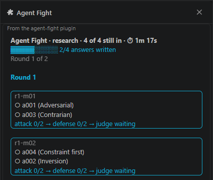
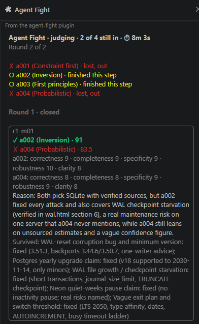

# Agent Fight

A Claude Code skill for hard questions that need the right answer, not a quick one.

`/agent-fight:agent-fight` starts 8 sub-agents by default (`--medium` 6, `--quick` 4). Every one gets the
same question and a different research card, searches the web and writes an answer with sources.
The answers then fight in a single-elimination bracket: attack, defend, judge. You get one
recommendation with sources and the attacks it survived. It gives ideas, not code, and writes only
inside `.agent-fight/`.





## Install

Requirements: Claude Code, Python 3.8+ (`python3` must work in your terminal), web search for
sub-agents. Run in a Claude Code session, one at a time:

```
/plugin marketplace add shleyger-dotcom/Agent-Fight
/plugin install agent-fight@agent-fight
/reload-plugins
```

Update (run both, then restart Claude Code):

```
/plugin marketplace update agent-fight
/plugin update agent-fight@agent-fight
```

Remove: `/plugin uninstall agent-fight@agent-fight`.

## Use it

```
/agent-fight:agent-fight which platform is best for a small 2D mobile game, solo developer, no budget
/agent-fight:agent-fight --quick should I use Postgres or SQLite for this app
```

If the question has no criteria (budget, skills, audience, deadline), Claude asks for them once.
Run in accept-edits mode (Shift+Tab), or every sub-agent file asks for approval.
Start from a clean git folder and run `git status` afterwards: sub-agents should write only inside
`.agent-fight/`, and accept-edits mode does not stop one that writes elsewhere.

| flag | what it does |
| --- | --- |
| `--quick` | 4 agents. Two known options, a cheap mistake. |
| `--medium` | 6 agents. A medium choice. |
| (no flag) | 8 agents. A costly or disputed decision. |

## How it works

1. **Scout** lists the realistic options, without a recommendation.
2. **Spawn**: each agent gets the same task and one card (reasoning mode, workflow, research
   angle; 400 cards, no repeats) and writes an answer with sources.
3. **Attack, defend, judge**, round by round. Judges score on [the rubric](skills/agent-fight/rubric.md):
   correctness 30, completeness 25, robustness 20, specificity 15, clarity 10. A verified fatal flaw
   cannot win.
4. **Cold read** (6 and 8 agents): a neutral reviewer attacks the champion.
5. **Source check**: one agent opens every source of the final answer (OK, MISMATCH, UNREACHABLE, OUTDATED).

## What it costs

The skill is free. The tokens are yours. Approximate, +/- 20%. Opus judges cost more per token
than Sonnet agents, so the bill is higher than the token count suggests.

| agents | sub-agent calls | tokens per run |
| --- | --- | --- |
| 4 (`--quick`) | 21 | ~10M |
| 6 (`--medium`) | 38 (+ up to 1) | ~18M |
| 8 (default) | 54 (+ up to 7) | ~26M |

About 85% of the tokens are cache reads. One 4-agent run was measured (7.3M, 2026-11-09, simple
question); ~10M allows for harder questions. The measured run, per model:

| model | roles | calls | input | cache write | cache read | output |
| --- | --- | --- | --- | --- | --- | --- |
| Sonnet | scout, competitors, attackers, defenders, source check | 18 | 260 | 733,663 | 5,445,215 | 79,624 |
| Opus | judges | 3 | 38 | 177,702 | 833,804 | 7,881 |
| total | | 21 | 298 | 911,365 | 6,279,019 | 87,505 |

The orchestrator's own context is not included. The other rows scale ~0.48M per call by the call
count and are not measured. A long `CLAUDE.md` makes every call more expensive.
`python3 skills/agent-fight/bracket.py plan [--quick | --medium]` prints the size and writes nothing.

## Limits

- Scout, competitors, attackers, defenders and the source check run on Sonnet. Judges, the final
  check and neutral reviewers run on Opus. Both are Claude, so shared blind spots remain.
- The judges are Claude too. The winner is the strongest answer the tournament found, not proof.
- Sub-agents cannot see your chat, only `.agent-fight/<run>/task.md`. A vague question gives vague answers.

## Troubleshooting

| problem | fix |
| --- | --- |
| Command not found | Run `/reload-plugins` or restart Claude Code. |
| `python3: command not found`, or "Python was not found" on Windows | Install Python 3.8+. On Windows `python3` can be the Microsoft Store stub: the skill falls back to `python` or `py -3`. |
| Plugin does not update | Run both update commands above, then restart Claude Code. |

## For developers

`bracket.py` is the tournament state machine (standard library only). Tests, in any terminal:

```
python3 -m unittest discover -s tests -v
node --test hooks/fight.test.ts
```

On Windows, if `python3` is the Microsoft Store stub, use `py -3 -m unittest discover -s tests -v`. The Node test needs Node 22.18 or newer (native TypeScript support).

## License

MIT. See [LICENSE](LICENSE).
